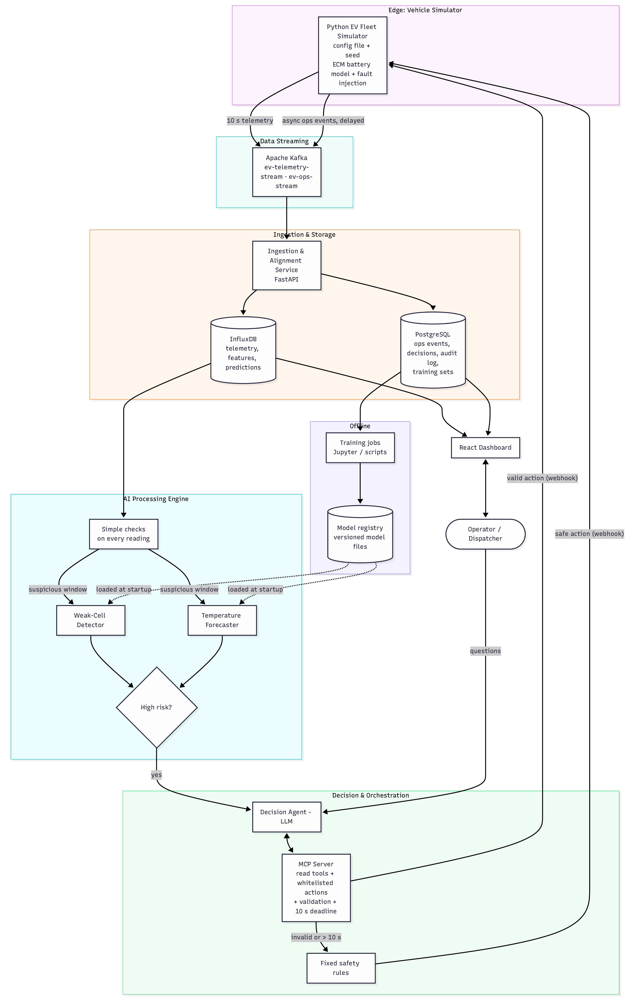

# Milestone 2: System Architecture and Implementation Plan
**Project:** AI-Enabled Connected Digital Twin Platform for EV Battery Fleet Monitoring  
**Domain:** Energy & EV Battery Fleet Management  

## 1. Problem and Industrial Context
**Problem Addressed:**  
Electric Vehicle (EV) batteries degrade unevenly. A single weak cell with high internal resistance shows rapid voltage drops and excessive localized heating during fast charging or heavy acceleration. Onboard Battery Management Systems (BMS) are reactive: they shut the vehicle down abruptly, and only after a hard safety limit has been crossed. Surface temperature sensors react with a delay, and existing fleet platforms only log data passively.

**Stakeholders:**  
EV Fleet Operators (e.g., logistics companies, public transport), Maintenance Engineers, and Dispatchers.

**Decision / Action Supported:**  
The system acts as a connected digital twin that continuously monitors cell-level health across the fleet. It answers three questions: *which* battery is abnormal (without false alarms), *why* (which cell, and how fast it is heating), and *what to do* before the BMS cuts out. When the risk is high, it intervenes automatically in the simulation with one of a short list of approved actions:
* cap the vehicle's current by 20% or 30%, so the weak cell can cool down without taking the vehicle out of service;
* reschedule a charging session;
* open a maintenance ticket.

The operator sees every decision with a short explanation on the dashboard, can inspect the diagnostics, and can ask the agent follow-up questions.

---

## 2. Data Sources
The simulator is calibrated offline on two real open datasets. During operation, it is the simulator that generates the live data. This lets us inject faults with known ground truth, something real field data cannot provide because it has no fault labels.

### 2.1 Real datasets (offline, used for calibration and validation)

| | IVST Changan EV Dataset ([Liu et al., 2025](https://doi.org/10.1038/s41467-025-56485-7)) | [Oxford Battery Degradation Dataset](https://ora.ox.ac.uk/objects/uuid:03ba4b01-cfed-46d3-9b1a-7d4a7bdf6fac) |
|---|---|---|
| **Type** | Field telemetry from 300 commercial EVs in real traffic | Controlled laboratory ageing of small pouch cells |
| **Structure** | Per-vehicle time series: pack current, multi-cell series voltages, temperature probes, driving and charging states | Per-cell cycling logs using an urban drive-cycle profile, with periodic capacity and OCV characterisation (roughly every 100 cycles) |
| **Relevant features** | Real current profiles (acceleration, regenerative braking, charging); normal spread between cells; seasonal temperature effects | OCV–SOC curve; capacity fade and resistance growth over cycles |
| **Frequency** | Seconds-scale sampling (exact rate to be confirmed later) | Characterisation checkpoints plus in-cycle time series |
| **Fault labels** | None | Known ageing state at each checkpoint |
| **Used for** | (1) Driving and charging profiles fed to the simulator; (2) cell spread in healthy packs; (3) **held-out vehicles** for checking temperature forecasts against *measured* temperatures | (1) Fitting the battery model (ECM) parameters; (2) ageing curves that drive fault injection (one cell ages faster) |

### 2.2 Simulated streams (online)
The simulator emits two independent streams, each on its own clock. Every record carries the time it happened in the simulation (`timestamp`), so the platform can detect late and out-of-order data.

1. **Battery Telemetry Stream (high frequency, every 10 s per vehicle):**
   * *Structure:* JSON payload with `vehicle_id`, `seq` (message counter, used for de-duplication), `timestamp`, `pack_voltage`, `pack_current`, an array `cell_voltages[]`, and `temperature_probes[]`.
   * *Ingestion:* published continuously to the Apache Kafka topic `ev-telemetry-stream`.
2. **Operations & Environment Stream (asynchronous, low frequency):**
   * *Structure:* JSON payload for discrete events: `vehicle_id`, `event_id`, `timestamp`, `event_type` (`CHARGING_START`, `CHARGING_END`, `ROUTE_ASSIGNED` with dispatch priority, `SPEED_UPDATE`, `WEATHER_UPDATE` with ambient temperature), and `value`.
   * *Ingestion:* published to a separate Kafka topic, `ev-ops-stream`, with random delays, occasional out-of-order delivery and duplicates, to simulate real network latency.
   * *Note:* acceleration is **not** sent as an event. The platform must infer it from `pack_current`, because telling a hard acceleration from a weak cell is one of the core problems (RFC, Challenge 2).

---

## 3. System Architecture

The architecture is event-driven and split into decoupled services, so it can scale and close the feedback loop between the AI and the simulated vehicles.

*Figure 1. System architecture. Click the image to open it at full size, or see the [PDF version](images/system-architecture.pdf).*

**System boundary:** everything in the diagram is built by us. The Changan and Oxford datasets enter only offline, for simulator calibration and forecaster validation. The only external service is the LLM provider's API. The simulator stands in for the vehicles and their onboard BMS.

**Key design decisions:**

| Component | Choice | Why |
|---|---|---|
| Streaming | Apache Kafka, two topics | Two decoupled streams on independent clocks; replay of past messages; scales for the load-spike test |
| Ingestion | FastAPI (Python) | Same language as the simulator and the models. Validates format and ranges, removes duplicates, and **flags** missing, broken or stuck values instead of guessing them |
| Stream alignment | Latest event per vehicle, max 30 s wait | Each telemetry reading is paired with the most recent event at or before its timestamp. Later events are still stored and correct the context, so live monitoring never waits (RFC Challenge 1) |
| Storage | InfluxDB + PostgreSQL | InfluxDB gives fast sliding-window queries on high-frequency telemetry; PostgreSQL holds relational data (events, decisions, audit log, training sets) and supports incident replay |
| AI engine | Tiered | Simple checks on every reading, models only on suspicious windows, agent only at high risk, which keeps cost and latency low |
| Decision | MCP server + fixed safety rules | The LLM can use only whitelisted, validated tools; the rules take over if its answer is invalid or later than 10 s |
| Feedback | Webhook to the simulator | Closes the loop: the simulator recalculates voltage and heat for the rest of the trip |
| Interface | React dashboard | Fleet status, cell-level detail, decisions with explanations, operator questions to the agent |

---

## 4. AI Decision Takers
To keep responsibilities separate and latency low, the system uses three AI modules, plus a deterministic safety layer that does not use AI.

1. **Weak-Cell Detector (unsupervised ML):**
   * *Input:* a 15-minute sliding window of `cell_voltages[]` and `pack_current`, together with the quality flags from ingestion.
   * *How it works:*
     * At every current step, it compares each cell's voltage drop with the **pack median** under the same current, which gives an estimate of the cell's resistance *relative* to its neighbours.
     * During hard acceleration every cell's voltage drops together, so subtracting the median removes that dip; only a genuinely weak cell stands out.
     * An **Isolation Forest**, trained on healthy packs, scores these per-cell features. A cell is flagged only if it stays abnormal over several consecutive windows, which suppresses one-off glitches.
   * *Output:* an anomaly score per cell, its estimated relative resistance, and a flag.
   * *Suitability:* real driving data has no fault labels, so the detector must be unsupervised. Isolation Forest is fast and lightweight and works well on a small set of features; the median normalisation handles the acceleration problem directly.
2. **Temperature Forecaster (predictive ML):**
   * *Input:* the last 15 minutes of current, voltage, cell temperature and ambient temperature.
   * *Output:* the predicted temperature of each cell 10 minutes ahead.
   * *Model:* **XGBoost** is the main model: it is fast, robust on tabular features (lags and rolling averages) and runs on CPU. An **LSTM** is trained as a comparison, and we keep whichever performs better on held-out vehicles.
   * *Suitability:* surface temperature probes react late, so a 10-minute forecast gives the system time to act *before* the critical temperature is reached.
3. **Fleet Management Agent (decision maker):**
   * *Input:* high-risk alerts from Models 1 and 2. Through MCP read tools, it also pulls the cell's history, the forecast and the trip context (remaining route, dispatch priority, next charging slot).
   * *Output:* exactly one command from a strict whitelist, with a short justification for the operator: `LIMIT_CURRENT_20`, `LIMIT_CURRENT_30`, `RESCHEDULE_CHARGING`, or `OPEN_MAINTENANCE_TICKET`.
   * *Suitability:* the right action depends on context. A high-priority route with a few kilometres left calls for something different than a vehicle about to fast-charge at the depot. An LLM can weigh this context and explain its choice, and because it is called only at high risk, API costs stay low.
   * *Safety:*
     * The MCP server exposes only the whitelisted tools and validates every parameter.
     * The 10 s deadline is enforced by the backend, not by the LLM.
     * Any invalid answer, timeout or crash triggers the fixed safety rules.
     * The LLM runs with temperature 0 and a pinned model version.
     * Every prompt, tool call and decision is stored in the audit log.

**Router and fixed safety rules (deterministic, no AI):**
* *Simple checks* on every reading flag a window as suspicious, for example when the voltage spread between cells is too large or the temperature rises too fast.
* *High risk* combines the detector's anomaly score with the gap between the forecast temperature and the critical limit. All thresholds live in the configuration file and are tuned on validation data.
* The *safety rules* are a fixed table: for example, if the forecast is very close to the limit, cap the current by 30% immediately; if a flagged vehicle is at a charger, reschedule its charging.
* The same rule table serves as a baseline in the evaluation.

---

## 5. Training and Inference
* **Training (offline):**
  * Models are trained offline in Jupyter notebooks and Python scripts on a team member's machine, never inside the live loop.
  * Training data comes from simulator runs stored in PostgreSQL. The simulator can run faster than real time, so it can produce many vehicle-days of data with injected faults (based on the Oxford ageing curves), each with known ground truth.
  * The real Changan data is used to validate the temperature forecaster.
* **Data splits:**
  * Always **by vehicle**, never by time step, so no information leaks between training and test.
  * **Fault types** are also held out: thresholds are tuned on one fault type and tested on others.
* **Storage and loading:**
  * Trained models are saved as files: `.pkl` for Isolation Forest and XGBoost, and ONNX for the LSTM.
  * Each model sits in a versioned model registry folder, next to a metadata file that records the training data, its parameters, its metrics and the git commit.
  * The backend loads the version marked as active when it starts.
  * A new model replaces the old one only if it performs better on the fixed test set.
* **Inference (online):**
  * The ML models stay in memory in the backend. They run on sliding windows queried from InfluxDB, but only when the simple checks mark a window as suspicious.
  * Predictions are stored in InfluxDB, so the dashboard and the evaluation see exactly what the system saw.
  * The LLM agent runs on demand: it is called through its API only when the risk is high.

---

## 6. Evaluation
* **Baselines:**
  * *End to end:*
    * **(B1) BMS only:** a run without our system, relying only on hard-coded BMS limits, which shut the vehicle down abruptly.
    * **(B2) Rules only:** the fixed safety rules without the LLM, which shows what the agent adds.
  * *Temperature forecaster:* **persistence**, which assumes that the temperature in 10 minutes equals the temperature now.
  * *Weak-cell detector:* (a) **BMS threshold**, which flags a cell only when it crosses the hard limit; (b) a **naive z-score on raw cell voltages**, without the pack-median comparison, which shows the value of handling acceleration.
* **Evaluation data:**
  * Simulated vehicles and fault types never seen in training; faults are injected at random cells and times, so the ground truth is known.
  * **Held-out real Changan vehicles**, where the 10-minute forecasts are compared with the temperatures the vehicles actually measured.
  * Real healthy trips with synthetic cell faults overlaid, to test detection on real driving patterns.
* **Expected Outputs:** per-cell anomaly scores and 10-minute temperature forecasts, plus a timeline of actions with justifications. The system should throttle vehicles with degrading cells in time, keeping peak temperatures below the critical limit while letting the vehicle finish its route.
* **Metrics:**
  * *Model level:*
    * Forecast RMSE and MAE (°C), compared with persistence.
    * Precision and recall for identifying the correct injected failing cell.
    * **Detection lead time:** how many minutes before the BMS limit the cell is flagged.
    * **False alarms per 1,000 vehicle-hours** on healthy fleets, including aggressive drivers.
  * *System level:*
    * Reduction in peak cell temperature.
    * Number of prevented hard shutdowns.
    * Minutes driven with reduced power.
    * Share of routes completed.
  * *Agent:* share of valid actions, response time (must stay under 10 s), and how often the fallback rules took over.
  * Numeric targets will be set after the first baseline results.
* **Failure Scenario (stress test): "Stale Sensor Drift."**
  * *Setup:* the simulator freezes a temperature sensor's output at a normal value while injecting high current into a weak cell.
  * *Detection:*
    * Ingestion flags the probe as **stuck**: its value does not change even though the current is high.
    * The forecaster then stops trusting that probe and uses the heat expected from the current and the cell's estimated resistance.
    * The gap between the expected and the reported temperature raises the risk level.
  * *Result:* the fixed safety rules apply a current cap even if the agent is confused by the stale data or does not answer within 10 s.
  * *Pass criterion:* the cell stays below the critical limit and no hard shutdown occurs.
* **Other stress tests (from the RFC):** lost data, a seasonal temperature change (train on mild weather, test on winter and summer), and a load spike with many more vehicles.

---

## 7. Implementation Plan

The project runs from Week 8 to Week 14, with the core work finished by Week 13 and Week 14 kept for final evaluation and delivery. We build in vertical slices: one thin working loop first (simulator → Kafka → ingestion → storage), then models, then the agent, so we always have something that runs end to end. Week numbers match the ones used in §2.1 and §6.

### 7.1 Timeline

| Week | Focus | Main tasks | Exit check |
|---|---|---|---|
| **8** | Setup, calibration, simulator v0 | Repo and `docker-compose` (Kafka, InfluxDB, PostgreSQL); config and stream schemas; get Oxford and Changan data, check licences, confirm Changan sampling rate (§2.1); fit ECM on Oxford; simulator for one vehicle with 10 s telemetry to Kafka | All services start with one command; same seed gives same output; healthy voltage curves look plausible next to Oxford |
| **9** | Full simulator and ingestion | Thermal model and fault injection; ops stream with delays, duplicates and out-of-order events; command webhook; ingestion (validation, stuck/missing flags, de-duplication, 30 s alignment) into InfluxDB and PostgreSQL | 50-vehicle fleet streams end to end; duplicates removed; frozen probe flagged as stuck |
| **10** | Data and first models | Generate labelled training sets; split by vehicle and fault type; simple checks and safety-rule table; Weak-Cell Detector (Isolation Forest) and its baselines | Detector runs on a held-out fleet and is compared with both baselines |
| **11** | Forecaster and baseline results | XGBoost and LSTM forecasters, validated on held-out Changan vehicles; persistence baseline; model registry; end-to-end runs of B1 and B2 | Baseline table ready; targets  |
| **12** | Agent and closed loop | MCP server (read tools, whitelisted actions, validation, 10 s deadline); LLM agent; high-risk router; webhook to simulator; safety-rule fallback; audit log | Injected fault → alert → action → temperature goes down, with no manual steps |
| **13** | Dashboard and stress tests | React dashboard (fleet, cell detail, decisions with explanations, agent questions); four stress tests: Stale Sensor Drift, lost data, seasonal change, load spike | Each stress test has a recorded pass or fail |
| **14** | Final evaluation and delivery | Many-seed runs of B1, B2 and the full system; model, system and agent metrics; fixes; final report; demo script and backup recording | Results table complete; demo runs from a clean start |

### 7.2 Checkpoints

* **End of Week 9:** data pipeline works end to end (simulator → Kafka → ingestion → databases).
* **End of Week 11:** first baseline numbers exist and the targets are set.
* **End of Week 12:** the feedback loop is closed (AI decision changes the simulated vehicle).
* **End of Week 14:** final evaluation and demo.

